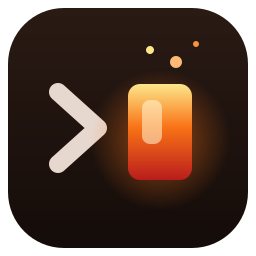
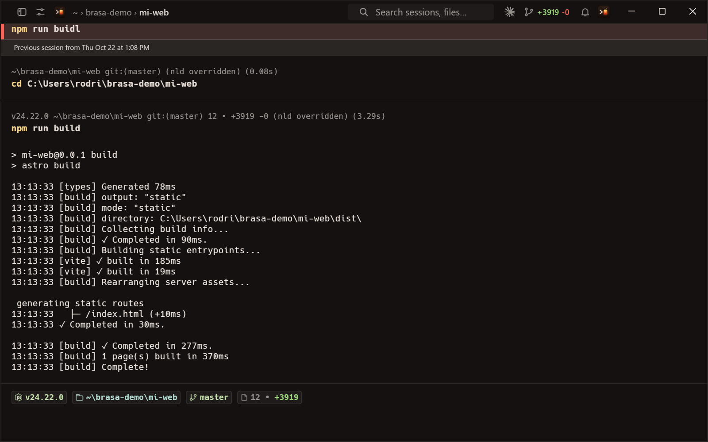
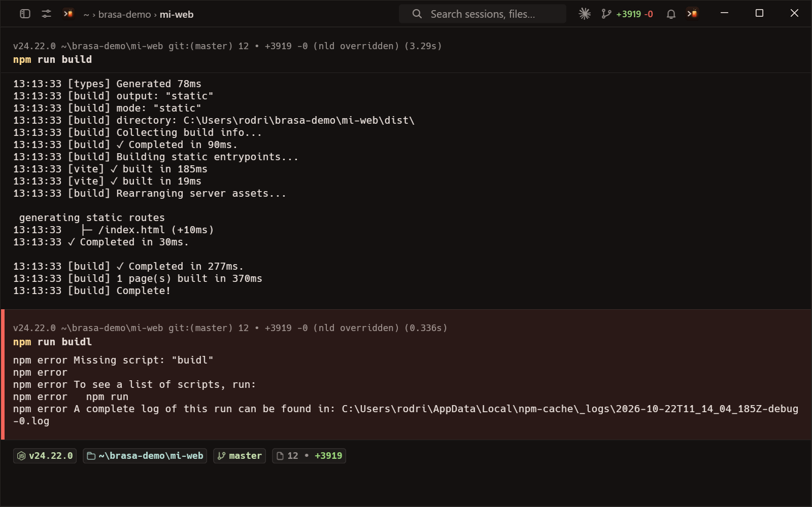
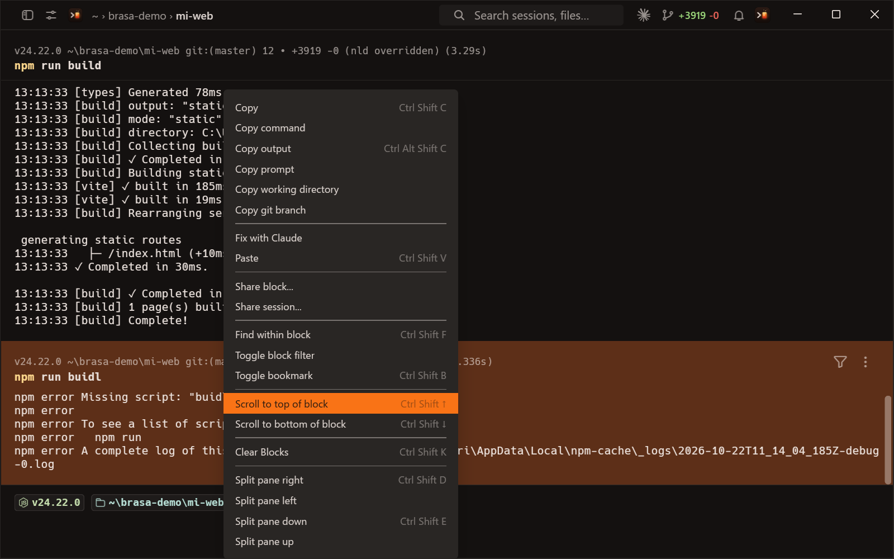
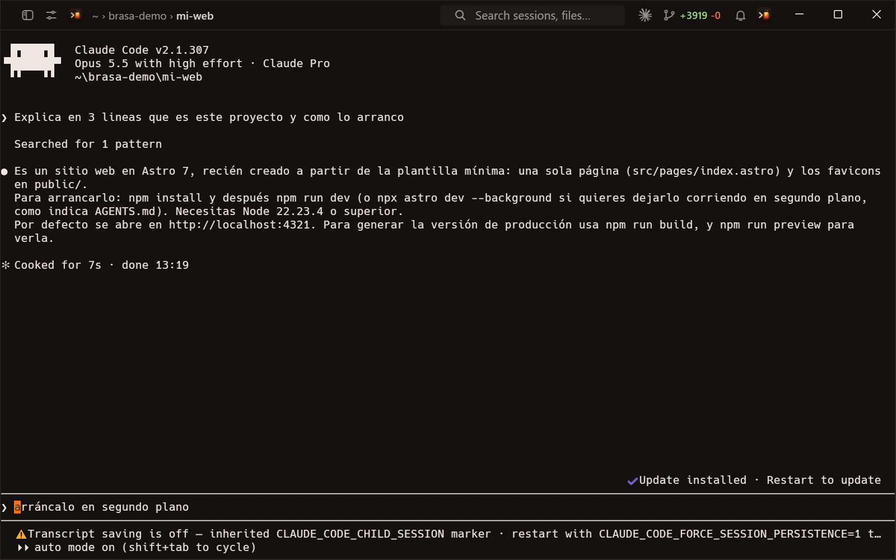

<p align="center">
  
</p>

<h1 align="center">Brasa</h1>

<p align="center">
  <b>La terminal cálida para Windows: rápida, gratis y con Claude dentro.</b><br>
  Hecha por <a href="https://sifg.net">SifG22</a> · <a href="https://github.com/SifG22">github.com/SifG22</a>
</p>

<p align="center">
  <a href="https://github.com/SifG22/brasa/releases/latest"><b>⬇ Descargar para Windows</b></a> ·
  <a href="#funciones">Funciones</a> ·
  <a href="#ejemplos">Ejemplos</a> ·
  <a href="#atajos">Atajos</a> ·
  <a href="#preguntas-frecuentes">Preguntas</a> ·
  <a href="#licencia-y-créditos">Licencia</a>
</p>

<p align="center">
  
</p>

## Qué es Brasa

Brasa es una terminal moderna para Windows pensada para programar con IA. Cada comando aparece
como un **bloque** separado, con su carpeta, su rama de git y su duración, así que es fácil ver
qué ha pasado, copiarlo o pedirle ayuda a Claude.

- **100 % gratis y sin cuenta.** No hay inicio de sesión, planes de pago, telemetría ni nube.
  Brasa no se conecta a ningún servidor: todo funciona en tu PC, también sin internet.
- **Claude Code dentro.** Ábrelo con un clic en la carpeta en la que estás y deja que lea, edite
  y ejecute tu proyecto mientras tú sigues en la terminal.
- **Fix with Claude.** Cuando un comando falla, clic derecho → *Fix with Claude*: Claude Code se
  abre con el comando y el error ya entregados, y te explica y arregla el problema en español.
- **Diseño propio.** Temas *Brasa Dark* y *Brasa Light* en carbón cálido con acento de brasa,
  pestañas en un carril lateral y la ruta de la carpeta siempre visible arriba.
- **Hecha para Windows.** x64 y ARM64 (Snapdragon), PowerShell, Git Bash y WSL, sin ventanas de
  consola sueltas, con instalador y actualizaciones automáticas.

## Descarga e instalación

1. Ve a [Releases](https://github.com/SifG22/brasa/releases/latest) y descarga el instalador de tu PC:

   | Tu PC | Instalador |
   | --- | --- |
   | Intel o AMD (la mayoría) | `Brasa-Setup-x64.exe` |
   | Snapdragon / ARM (Surface Pro X, Copilot+ PC…) | `Brasa-Setup-arm64.exe` |

2. Ábrelo. Se instala solo para tu usuario, sin pedir permisos de administrador.
3. Busca **Brasa** en el menú Inicio.

Brasa comprueba una vez al día si hay versión nueva y te pregunta antes de actualizarse.
Para usar Claude Code instala antes [Claude Code](https://claude.com/claude-code) (el comando
`claude`).

## Funciones

### Bloques de comandos

Cada comando y su salida forman un bloque. Los que fallan se marcan en rojo, y encima de la
entrada tienes siempre a mano la versión de Node, la carpeta, la rama de git y los cambios
pendientes.

<p align="center">
  
</p>

### Fix with Claude

Clic derecho sobre cualquier bloque: si el comando falló verás **Fix with Claude**; si no,
**Ask Claude**. Brasa abre Claude Code en una pestaña nueva, en esa carpeta, con el comando y el
final de su salida.

<p align="center">
  
</p>

### Claude Code a un clic

El botón ✦ de la barra superior (o **Ctrl+Shift+H**) abre Claude Code en la carpeta en la que
estás. Funciona como en cualquier terminal: colores, teclas, pegar, cambiar el tamaño y hacer
scroll.

<p align="center">
  
</p>

## Ejemplos

### Crear una web con Astro

```powershell
npm create astro@latest mi-web -- --template minimal --install --yes
cd mi-web
npm run dev        # servidor de desarrollo en http://localhost:4321
npm run build      # genera la web en dist/
```

Con la web creada, pulsa **Ctrl+Shift+H** y pídele a Claude, por ejemplo:

> Añade una página /blog con tres artículos de ejemplo en Markdown y un menú arriba.

Si `npm run build` falla, clic derecho en el bloque rojo → **Fix with Claude**.

### Otros proyectos web

```powershell
npm create vite@latest mi-app -- --template react-ts   # React + Vite
npx create-next-app@latest mi-next                      # Next.js
npx sv create mi-svelte                                 # SvelteKit
```

### Python

```powershell
python -m venv .venv
.venv\Scripts\Activate.ps1
pip install fastapi uvicorn
uvicorn main:app --reload
```

### Git sin salir de la terminal

```powershell
git status
git switch -c nueva-funcion
git commit -am "Primera versión"
```

La rama actual y el número de archivos cambiados se ven siempre en la barra de la entrada y en
la barra superior.

## Atajos

| Acción | Atajo |
| --- | --- |
| Abrir Claude Code en la carpeta actual | Ctrl+Shift+H |
| Nueva pestaña | Ctrl+Shift+T |
| Dividir el panel a la derecha / abajo | Ctrl+Shift+D / Ctrl+Shift+E |
| Buscar dentro de un bloque | Ctrl+Shift+F |
| Copiar / pegar | Ctrl+Shift+C / Ctrl+Shift+V |

Todos los atajos se pueden cambiar en **Settings → Terminal → Keyboard shortcuts**.

## Preguntas frecuentes

**¿Necesito una cuenta o internet?** No. Brasa no tiene cuentas y no envía nada a ningún
servidor. Solo usa internet para buscar actualizaciones en este repositorio, y Claude Code
para hablar con Claude.

**¿Cuánto cuesta?** Nada. Brasa es gratis. Claude Code usa tu propia cuenta de Claude.

**¿Funciona en macOS o Linux?** Por ahora Brasa se publica solo para Windows. El código compila
también en macOS y Linux, y llegarán más adelante.

**¿Dónde guarda sus datos?** En `%APPDATA%\sifg\Brasa` y `%LOCALAPPDATA%\sifg\Brasa`.

## Compilar desde el código

```bash
cargo run --bin brasa
```

En Windows ARM64 también hacen falta `protoc` y `clang-cl` (LLVM): define
`CC_aarch64_pc_windows_msvc` con la ruta a `clang-cl.exe`. El instalador se genera con
`script/brasa/empaquetar.ps1 -Arch x64 -Instalador` (necesita Inno Setup 6). La guía técnica
completa está en [AGENTS.md](AGENTS.md).

## Licencia y créditos

Brasa es un **trabajo derivado de [Warp](https://github.com/warpdotdev/warp)**
(warpdotdev/warp), un cliente de terminal de código abierto. Brasa no está afiliada a Warp ni
respaldada por Warp; "Warp" es una marca de sus dueños.

- El framework de interfaz (crates `warpui_core` y `warpui`) se distribuye bajo licencia
  [MIT](LICENSE-MIT).
- El resto del código se distribuye bajo licencia [AGPL v3](LICENSE-AGPL).

Los cambios de Brasa son © SifG22 y se publican bajo las mismas licencias. Como exige la AGPL,
el código fuente completo de Brasa está siempre disponible en este repositorio.

Brasa también se apoya en muchos proyectos libres, entre ellos
[Alacritty](https://github.com/alacritty/alacritty), [Tokio](https://github.com/tokio-rs/tokio),
[Hyper](https://github.com/hyperium/hyper), [FontKit](https://github.com/servo/font-kit) y
[NuShell](https://github.com/nushell/nushell).
